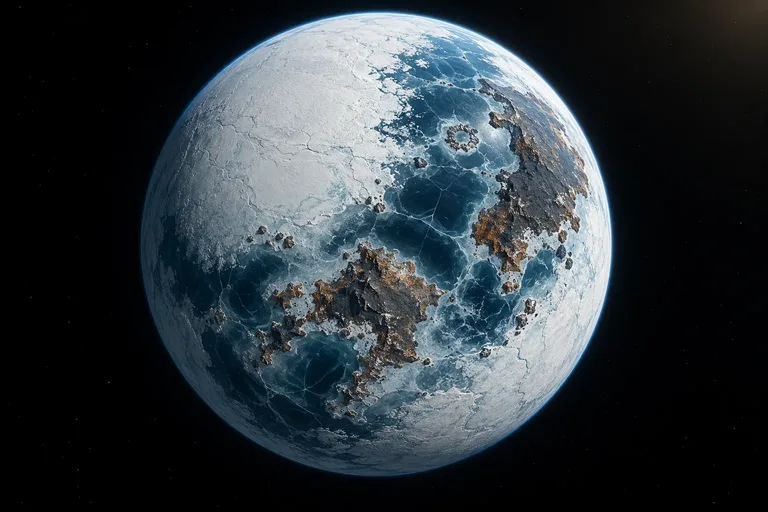

# PSU-7 · Planetary Survey Unit

A survey instrument for imagined planets. Pick a star, an orbit and an atmosphere, or start from a confirmed NASA exoplanet, and PSU-7 computes the world's physics, then has Claude write a field note and an image model paint it from orbit and from the ground.

The split is the point: **a deterministic model owns every number, and the language model owns the prose.** Each field note comes back as sections tagged _calculated_, _estimated_, _assumed_ or _imagined_. The interface shows the tags, so the writing can be vivid without hedging every clause, and an eval checks that the prose never contradicts the data panel.



## What to look at

| Area                    | Where                                                                                                                            | What it shows                                                                                                                                                                                                                                                                      |
| ----------------------- | -------------------------------------------------------------------------------------------------------------------------------- | ---------------------------------------------------------------------------------------------------------------------------------------------------------------------------------------------------------------------------------------------------------------------------------- |
| Prompts                 | [`lib/prompts.js`](lib/prompts.js)                                                                                               | Every Claude prompt in one file: a byte-stable, cached system prompt; curated notes as few-shot examples; a compact fact sheet in place of raw model JSON; JSON-schema structured output.                                                                                          |
| Agent                   | [`api/agent.js`](api/agent.js), [`lib/agent-tools.js`](lib/agent-tools.js), [`lib/field-researcher.js`](lib/field-researcher.js) | "Ask the field researcher": Claude searches the NASA catalogue and runs the physics model through tools that execute **in the browser**. The server only proxies model turns, owns the prompt and tools, and checks a submitted note against recomputed physics before signing it. |
| Evals                   | [`lib/narrative-checks.js`](lib/narrative-checks.js), [`scripts/eval-narratives.js`](scripts/eval-narratives.js)                 | Contradiction checks (haze on airless worlds, waves on frozen ones, sunsets on tidally locked ones, star colour, ungrounded temperatures, invented moons) plus hedges per sentence, reported with Wilson intervals. The same checks guard agent submissions.                       |
| Physics                 | [`lib/planet.js`](lib/planet.js)                                                                                                 | One module shared by browser and server: flux, Kepler periods, sidereal vs solar day, escape velocity, density, a greenhouse offset, ice albedo and airless mean-temperature bounds. Versioned, so saved reports keep their numbers.                                               |
| Provenance and security | [`lib/attest.js`](lib/attest.js), [`lib/provenance.js`](lib/provenance.js), [`lib/server.js`](lib/server.js)                     | Paid routes reserve atomic Upstash quotas and fail closed. NASA records, AI notes and images carry HMAC signatures, so a public link cannot show uploaded text as AI-written or invented values as NASA data.                                                                      |

## How a survey flows

```
browser                                   server (Vercel functions)              providers
───────                                   ─────────────────────────              ─────────
lib/planet.js computes physics ──┐
                                 ├─ POST /api/analyze  (params only) ─► validate · quota ─► Claude: fact sheet → tagged JSON
render report immediately        │                                     sign note ◄────────┘
                                 ├─ POST /api/image    (params only) ─► validate · quota ─► image model ─► Blob, signed URL
                                 └─ POST /api/reports  (snapshot)    ─► keep only signed content ─► Blob, public link

field researcher loop (browser)  ─ POST /api/agent (brief + tool results) ─► fixed prompt + tools ─► Claude
   runs search_catalogue / compute_world locally ◄── tool_use ───────────┘
   submit_field_report ───────────────────────────► recompute physics · eval checks · sign
```

Clients never send a prompt. Every route accepts structured parameters, validates them against enums and numeric ranges, and builds the prompt on the server.

## Run it

Node.js 24.

```sh
npm ci
npm run dev        # http://127.0.0.1:3000
```

The reference worlds, physics and model notes work with no credentials. For live notes, images and sharing, copy `.env.example` to `.env.local` and fill in the keys it lists; [docs/REFERENCE.md](docs/REFERENCE.md) covers Vercel, Blob and Upstash setup.

## Checks

```sh
npm run lint        # Prettier
npm run check       # syntax of every module
npm run typecheck   # tsc over JSDoc types (no build step)
npm test            # unit, API, storage, provenance, agent and eval-checker tests
npm run eval        # field-note checks on the curated notes (free)
npm run eval:live   # 40 live field notes through the production prompt (paid)
npm run test:browser
```

CI runs all of these except `eval:live`, plus a real-Redis concurrency test and axe accessibility audits.

## Design decisions

- **Plain JavaScript, no framework or bundler.** The browser loads ES modules as written. Types come from JSDoc checked by `tsc --noEmit`, starting with the modules that carry security and LLM contracts.
- **Structured output over prose parsing.** Notes use `output_config.format` with a JSON schema; the server validates the sections, rebuilds the description from them and rejects anything else.
- **Curated notes are labelled as curated.** Boreal, Cinder and Viridia have hand-written notes, shown as "Curated reference note". They are the few-shot examples, and a test checks every temperature they quote against the model.
- **Physics changes are versioned.** Adding ice albedo moved Boreal from −25 °C to −43 °C. Reports carry `physicsVersion`, so a link published under the old model still shows its original numbers.

## More

- [Reference](docs/REFERENCE.md): deployment, quotas, report format, cartography experiment
- [Operations](docs/OPERATIONS.md): cost ceiling, firewall rules, takedowns, key rotation, live evals
- [Showcase collection](docs/SHOWCASE_COLLECTION.md) and [planetary cartography](docs/PLANETARY_CARTOGRAPHY.md)
- [Archive](docs/archive/): earlier Awwwards submission planning
