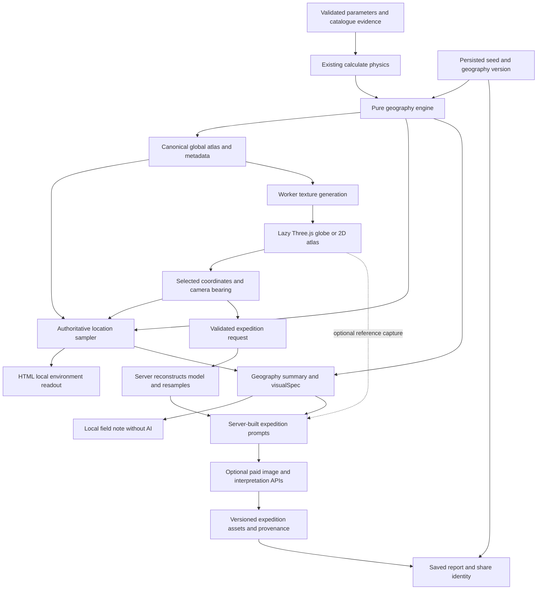

# PSU-7 — Procedural Planetary Cartography

Architectural investigation · 20 October 2026 · based on repository commit `80f36f3`.

This document proposes future work only. No renderer, geography engine, dependency installation or application change is part of this investigation. Effort and performance figures below are planning estimates, not measured prototype results. External references identify relevant technologies; provider capabilities, current prices and bundle sizes must be checked against the versions selected during implementation.

## 1. Executive summary

Build an explorable **deterministic cartographic globe**, not an AI-generated globe texture. Its geography should become the authority for coordinates, regional descriptions and expedition inputs. Keep AI photographs as explicitly interpretive products derived from that geography; never treat their invented coastlines as map data.

Use **Three.js directly**, lazy-loaded into the existing vanilla JavaScript application. Start with a spherical mesh, generated surface texture, restrained atmospheric shell, directional lighting, coordinate picking and an HTML location readout. No React migration, game engine, real-time tectonics or planet-scale terrain streaming is necessary.

Recommend **hybrid geography**: a versioned CPU sampler on the unit sphere, plus a small precomputed global atlas for sea-level calibration and environmental fields. A worker builds render textures from the same sampler. The CPU sampler remains authoritative; shaders handle appearance rather than independently inventing terrain. Add high-resolution detail later without changing established coastlines or named sites.

The first release should make rotation, zoom and coordinate inspection compelling **without any paid API calls**. Coordinate-specific AI imagery should follow only after location persistence, server-side resampling and provenance work. Text prompts can deliver environmental consistency; reference images can improve regional resemblance but cannot guarantee exact landmarks. Near-seamless descent is a terrain-rendering project, not a prompt-engineering milestone.

## 2. Current architecture assessment

### Repository findings

| Component                          | Current behavior                                                                                                      | Reuse and boundary                                                                                                                                                                        |
| ---------------------------------- | --------------------------------------------------------------------------------------------------------------------- | ----------------------------------------------------------------------------------------------------------------------------------------------------------------------------------------- |
| `lib/planet.js` validation         | Canonicalizes parameter order, checks numeric ranges and atmospheric compatibility; preserves catalogue mass/radius   | Reuse before all geography generation. New seed/version/location fields need explicit validation; `validateSurvey()` currently rejects keys other than `params`, `catalog`, `view`.       |
| `calculate()`                      | Shared browser/server educational physics and rules                                                                   | Retain as the upstream physical authority. Do not let a renderer or AI revise its outputs.                                                                                                |
| `geographySpec()`                  | FNV-style 32-bit hash over validated physical parameters excluding biosphere mode; seeded compositional prose         | Deterministic descriptions, **not** a spatial field, plate map or mesh. Replace its new-world behavior with a summary of numerical geography; preserve a legacy path.                     |
| `surfaceSiteSpec()`                | Hashes geography prose to choose a `Region NNN` and an imagined regional setting                                      | No latitude/longitude, geometry or globally unique identity. Cannot recover an actual coastline or site from existing images. Retire as the cartographic authority for new worlds.        |
| `visualSpec()` / `biosphereSpec()` | Shared terrain, palette, sky, illumination and explicitly imagined biology; gravity-dependent morphology              | Reuse the constraints and vocabulary. Adapt their spatial descriptions to consume a model/location, rather than add a competing noise system.                                             |
| `imagePrompt()`                    | Seven sections; separate orbital/surface camera templates; shared geography and regional prose                        | Reuse structure. Future prompts serialize server-derived regional samples, local illumination and reference context.                                                                      |
| `analysisPrompt()`                 | Separates calculated, estimated, assumed and imagined information; receives catalogue context                         | Reuse evidence language. Add typed location facts, not client-written descriptions.                                                                                                       |
| `api/image.js`                     | Server builds prompt; `gpt-image-1`, generations endpoint, one 1536×1024 medium WebP; 45s provider timeout            | Preserve credentials, validation and single-request behavior. Current request accepts **no reference image**. Location and reference support are future API work.                         |
| `api/analyze.js`                   | Recalculates physics, requests Anthropic JSON narrative, validates shape                                              | Reuse provider/error handling and narrative schema principles; add separately scoped site notes.                                                                                          |
| `lib/server.js`                    | Input size limit, upstream timeouts, safe errors, Redis hourly/daily/concurrency quotas                               | Reuse for paid expedition operations. Globe sampling should need none of these provider calls.                                                                                            |
| `app.js`                           | Native ES modules, imperative DOM, report state, per-report/view tasks, late-response protection                      | Natural small integration point for a mounted explorer controller. Current task keys are report + kind, not report + coordinates + camera.                                                |
| `lib/client-report.js`             | Version-2 reports serialize parameters, catalogue, narrative and `images.orbital/surface`; restore recomputes physics | Add versioned geography identity and expeditions through a migration. Restoration currently drops unknown fields.                                                                         |
| `lib/storage.js`                   | Signed Blob image URLs, validated report persistence, public share IDs                                                | Reuse storage plumbing; extend validation. Present signatures authenticate the URL, not association with a planet, coordinate or camera.                                                  |
| UI / styling                       | Editorial instrument, gold/ink/paper palette, image stage, numerical grid, native dialogs, reduced-motion behavior    | Keep report and controls. Mount an independent canvas beside the image button, not inside its clickable expansion control.                                                                |
| Build / dependencies               | Copy-based static build, no bundler, React or existing 3D dependency; only production dependency is Blob SDK          | Native dynamic import is supported conceptually, but bare `three` imports and worker files will not be deployed by the current copy allowlist. Add an isolated renderer build step later. |

### Physical information already available

Inputs include stellar class, orbital-zone assumption, atmosphere class, assigned water/ice coverage, mass, radius, tilt, rotation and pressure. Catalogue data may supply mass, radius, period, semi-major axis, equilibrium-temperature estimate and stellar mass/radius/luminosity. Report identity is a UUID; **there is no explicit persisted planet seed**. Randomized control choices are not a persistent cartographic random stream.

Computed outputs include gravity, bulk density, escape speed, orbital distance and period, equilibrium temperature, pressure-scaled greenhouse offset, mean temperature, solar day, stellar angular diameter, water-phase approximation, classification, warnings, Surface Environment Index and ESI. These are not a local climate solver. No elevation, terrain coordinates, moisture, seasons, wind, geological age, orbital epoch or surface chemistry map is calculated. Tidal locking is not inferred from stellar type: `solarDayHours === null` identifies the selected synchronous scenario. Binary systems use combined stellar properties and do not establish two visible stellar positions.

`waterState()` already returns uncertainty outside supported saturation ranges. Preserve that uncertainty in local maps. Do not reinterpret blue pixels as proof of liquid water. The Surface Environment Index and ESI stay global and unchanged; neither becomes a local human-safety score.

### Image and report association today

A report holds one narrative and one asset per orbital/surface view. Client tasks attach responses to their originating report and deduplicate repeated view requests. Local storage, report export and Blob-backed public sharing preserve the assets; imported/shared reports recalculate physics. There is no spatial asset cache, geography version, camera orientation, image reference provenance or named-site collection.

The initial survey currently starts interpretation and orbital generation when capabilities permit. A zero-paid-call cartography mode therefore also needs a future interaction change: select cartography before those jobs start, or make AI illustration explicit. Simply adding a canvas would not remove those existing charges.

### Existing verification to preserve

Node tests cover physical references, phase edges, atmosphere compatibility, catalogue precision, scoring, deterministic prose, eight image scenarios, API faults, quotas, Blob round trips and build exclusions. Playwright/axe cover mobile layouts, native dialogs, async races, image retries/deduplication, sharing and layout shift. Extend these; do not replace them with screenshots alone. Prettier and syntax checks are already in CI.

## 3. Rendering technology comparison

The following bundle estimates are order-of-magnitude planning ranges for additional compressed JavaScript, not audited package measurements. Actual imports, versions and shader code must be measured with the first prototype.

| Option                                   | Visual quality and procedural control                                                    | Performance / mobile                                                                                            | Size and complexity                                                                 | Fit / future detail                                                                                                      |
| ---------------------------------------- | ---------------------------------------------------------------------------------------- | --------------------------------------------------------------------------------------------------------------- | ----------------------------------------------------------------------------------- | ------------------------------------------------------------------------------------------------------------------------ |
| **Direct Three.js**                      | Strong materials, custom shader hooks, raycasting and generated textures                 | Good with restrained passes and resolution; touch controls available                                            | Plan roughly 150–250 KB gzip for a focused renderer; moderate implementation effort | Best fit for native JS; custom LOD meshes possible later                                                                 |
| React Three Fiber                        | Same underlying Three.js quality; useful declarative scene lifecycle in React apps       | Can perform well, but does not solve texture or shader budgets                                                  | Adds React, React DOM, reconciler and Three.js; significant architecture cost here  | No existing React tree to reuse; do not select for PSU-7                                                                 |
| Custom WebGL2                            | Maximum control over raymarched/analytic spheres and shader cost                         | Potentially smallest and fastest; developer owns compatibility, picking, resource disposal and context recovery | Could be tens of KB, excluding geography; high engineering/testing burden           | Useful later for a proven bottleneck; premature as the initial renderer                                                  |
| Globe.gl / three-globe                   | Quick globe, overlays and markers; terrain-specific materials may require escape hatches | Reasonable for restrained scenes; disable Earth-centric defaults                                                | Three.js plus wrapper layers; inspect exact bundle rather than assume lightweight   | Good data-globe tooling, less direct control for invented planetary materials and terrain                                |
| CesiumJS                                 | Excellent geospatial camera, terrain streaming and precision architecture                | Powerful but substantial browser/GPU footprint                                                                  | Typically a much larger, MB-class deployment with assets/workers                    | Arbitrary-body adaptation and custom terrain are possible but excessive for orbital MVP; no reason to use Earth services |
| Canvas 2D map / simple sphere projection | Adequate atlas and location picking; limited atmospheric and lighting quality            | Best low-power fallback, zero WebGL requirement                                                                 | Small; low/moderate complexity using the same atlas                                 | Essential fallback; cannot provide smooth terrain descent                                                                |

**Recommendation:** direct Three.js, one sphere and minimal layers. Use its camera, raycaster and orbit controls; write only the small planetary material additions needed. A globe wrapper offers little advantage over this scene. Keep a 2D atlas fallback from the same data. Do not add React, physics middleware, GIS services or Earth basemap assets.

Reference documentation for implementation evaluation: [Three.js installation](https://threejs.org/manual/en/installation.html), [OrbitControls](https://threejs.org/docs/#examples/en/controls/OrbitControls), [React Three Fiber introduction](https://r3f.docs.pmnd.rs/getting-started/introduction), [Globe.gl](https://globe.gl/), [CesiumJS](https://cesium.com/platform/cesiumjs/), [WebGL best practices](https://developer.mozilla.org/en-US/docs/Web/API/WebGL_API/WebGL_best_practices). These links are not evidence of measured PSU-7 performance.

## 4. Recommended technical architecture

Keep the physics-first pipeline, adding a spatial rules layer before prose or rendering:



Proposed separation:

- `lib/geography.js`: pure browser/Node code, version dispatch, seeded fields, atlas metadata and location sampling. No DOM, Three.js, fetch or AI imports.
- `lib/geography-worker.js`: cancellable atlas/texture construction and transferable arrays. Main thread retains enough canonical data for cheap picking samples.
- `lib/globe.js`: mount/update/dispose controller, renderer, controls, raycasting and lifecycle. No authoritative climate calculations.
- Existing `lib/planet.js`: validation, physics and environmental constraints; adapters summarize geography and locations into its established prompt vocabulary.
- Future expedition endpoints and report adapters: validate coordinates/version, reconstruct server-side, apply quotas, store outputs. Browser-supplied temperatures and terrain names are never trusted.

Avoid a circular import: `planet.js` must not import a geography module that also imports all of `planet.js`. Put common pure phase/environment primitives into a small shared module if needed, or inject validated physics/phase helpers into geography creation. Select one direction during implementation and test imports in both Node and browser. Geography never calls AI.

Dynamic import can mount the explorer on first activation and dispose it when changing reports. Extend `scripts/build.js` to copy new modules and invoke a narrowly scoped renderer bundle step; use a small build-only bundler if needed, or a reproducibly generated, self-hosted ESM vendor bundle. Do not assume node_modules is served, use an unpinned CDN import, or rewrite the whole app around a bundler. Workers and assets must be same-origin; review `worker-src 'self'` explicitly in the CSP rather than loosening the policy broadly. Update the production-build allowlist test, which currently expects only two public `lib` files.

## 5. Proposed geography data model and APIs

The following are **design contracts**, not implemented functions.

```text
GeographyIdentity
  schemaVersion, algorithmVersion, physicsVersion, seed
  physicalInputDigest, climateSettings, identityDigest

PlanetGeography
  identity, bodyKind: solid | gas-envelope
  radiusMeters, globalConstraints, seaLevelDatum
  canonicalGridSpec, calibratedCoverage, coverageError
  lowFrequencyFields, featureDescriptors, warnings

createPlanetGeography(validatedParams, calculatedPhysics, identity)
samplePlanetLocation(geography, latitudeDeg, longitudeDeg, options)
summarizeGeography(geography)
summarizeRegion(geography, location, bearingDeg, fieldOfViewDeg)
buildRenderAtlas(geography, resolution, displayMode)
```

The conceptual `samplePlanetLocation(planet, lat, lon)` should resolve to a prepared `PlanetGeography`, not rebuild its global maps on every pointer event. A caller may accept a report and retrieve a cached model as a convenience wrapper.

A sample returns:

| Field                                                             | Meaning / provenance                                                                                             |
| ----------------------------------------------------------------- | ---------------------------------------------------------------------------------------------------------------- |
| `modelId`, canonical coordinates, `cellId`                        | Versioned identity and stable reference location                                                                 |
| `bodyKind`, `surfaceAccessible`                                   | Distinguishes solid model from gas-envelope cloud reference                                                      |
| `elevationMeters`, `waterDepthMeters`, `surfaceClass`             | Modeled terrain datum, liquid/ice basin depth and land/ocean/ice/dry classification; nullable where inapplicable |
| `temperatureC`, `temperatureRangeC`, `pressureBar`, `densityKgM3` | Local approximations with method and uncertainty; nullable when unsupported                                      |
| `waterPhase`, `iceFraction`, `snowFraction`                       | Phase-consistent indicators, not detected water or simulated ice thickness                                       |
| `moistureIndex`, `precipitationClass`                             | Relative proxy and qualitative class; not millimeters/year without calibration                                   |
| `terrainType`, `biome`, `features`                                | Deterministic classifications and feature IDs, with geological process hypotheses separated from geometry        |
| `biosphere`                                                       | Existing imagined mode, presence gate, pigments, morphology and local habitat; never probability of life         |
| `illumination`                                                    | Viewing epoch/assumption, sun direction, solar elevation/azimuth where defined                                   |
| `visualDescriptors`, `warnings`, `provenance`                     | Derived descriptors, support limits, and per-field calculated/estimated/assumed/imagined status                  |

Coordinates use degrees, latitude [-90, 90], east-positive longitude normalized to [-180, 180). Define the prime meridian as an arbitrary persisted cartographic convention, not an observed rotational longitude. Normalize longitude at the poles to zero for identity and deduplication. Reject nonfinite coordinates and out-of-range latitude. Use unit vectors for calculations; define and test the render-axis mapping and north/east tangent basis. Globe rotation changes the camera, never the stored geographic coordinate.

Persist coordinates as fixed-point microdegrees for request identity, while displaying only sensible precision. Microdegree storage does **not** imply meter-scale model accuracy. An expedition key includes model identity, canonical coordinates, heading, FOV, selected model epoch, art mode and prompt/reference version. LOD, texture resolution and device pixel ratio do not change the sampled world or key.

## 6. Deterministic generation strategy

### Seed, identity and versioning

Persist an explicit seed independent of report UUID, display name and art mode. Initially derive it from a canonical physical-parameter digest for continuity with current behavior; a future explicit “new geography” action can mint a new seed. Freeze it on creation. Editing an environment creates a new model identity, even if a deliberate scenario variation reuses the seed to preserve the same terrain scaffold.

Use a documented integer PRNG with known-answer tests and separate named streams (`plates`, `islands`, `craters`, `clouds`). Adding a cloud octave must not change continents. Do not seed from prose, object insertion order, timestamps, GPU random functions or render order. Include catalogue overrides that affect the environment in the physical-input digest. Biosphere mode belongs in appearance/expedition identity but must not change elevation or coastlines.

Pin generator and numerical conventions. Use the CPU field for classification; quantize authoritative atlas values and use explicit tie-breaking near thresholds. Test Node/Chromium/Safari parity; JavaScript transcendental functions and GPU precision should not be assumed bit-identical. Define tolerances for continuous samples and exact expected categorical IDs. For durable numerical identity across platforms, distribute canonical quantized fields and their checksum rather than claiming arbitrary floating-point evaluations are universally bitwise equal.

New reports need a schema migration and a separately versioned geography algorithm. Version 2 has no map to recover. Preserve its old images as “legacy artist interpretation”; create a cartographic realization on explicit upgrade and label it accordingly. Keep the old generator dispatch or frozen canonical atlas for published worlds. Never silently regenerate a coastline after a release or refresh catalogue values underneath an existing model identity.

### A, B or C?

| Approach                                    | Advantages                                                                                             | Costs / failure modes                                                                                                                  |
| ------------------------------------------- | ------------------------------------------------------------------------------------------------------ | -------------------------------------------------------------------------------------------------------------------------------------- |
| A. Precomputed maps/textures                | Fast rendering, stable global coverage, straightforward caching and sharing                            | Finite detail; texture interpolation can disagree with categorical shorelines; higher resolutions consume memory and bandwidth         |
| B. Arbitrary-coordinate procedural sampling | Compact seed storage, continuous sphere, easy local detail                                             | Expensive global coverage calibration; repeated noise evaluation; global moisture/drainage require context; shader/CPU divergence risk |
| **C. Hybrid**                               | Global constraints and low-frequency fields cached once; shared coordinate sampler adds bounded detail | Must explicitly separate immutable global fields from cosmetic LOD; modest atlas/version/cache infrastructure                          |

Choose C. For the earliest prototype, a CPU-generated 512×256 atlas plus a shared sampling contract is enough; increase visual texture resolution only after profiling. The architecture supports cube-face/quadtree refinement later without requiring it now.

### Global geography algorithm

1. Sample 3D deterministic gradient/simplex-style noise at unit-sphere vectors. Multiple frequency bands produce structure without a longitude seam or pinched polar texture artifacts. Pin the noise implementation/license. Domain-warp gently at low frequency to break regular shapes; unrestricted warping is a common cause of ribbon continents.
2. Place a small seeded set of sphere-distributed plate-inspired centers and compact continental cores. Spherical Voronoi adjacency, assigned drift vectors and boundary distances can bias broad uplifts/trenches. They are **artistic plate-inspired structure**, not plate evolution, crustal age or a tectonic prediction.
3. Combine broad compact cores with low-amplitude noise and short boundary ridges. Control component area and aspect ratio over a seed gallery. Connected-component diagnostics should discourage accidental paired tapering Americas-like arrangements without hardcoding terrestrial maps. No automatic detector can prove a map does not resemble Earth.
4. Compute a deterministic area-weighted elevation quantile for the sea/basin threshold. Equirectangular cells need cosine-latitude area weights; an equal-area calibration grid is another option. Keep the grid and interpolation rules fixed across display LODs. Handle exactly 0% and 100% as explicit cases.
5. Treat assigned water as area coverage/inventory, not total water mass. For liquid worlds, calibrate flooded basins to target coverage; for glacial worlds interpret the assigned fraction as ice-filled basin area. Dry/vapor/uncertain phases cannot gain blue seas just because a threshold exists. Record requested versus realized phase coverage and approximation error.
6. Add small archipelago cores and localized coastline detail before final calibration. Bound fine detail near established coasts so higher LOD cannot create a new island beneath an expedition or move the selected shoreline. Maintain coarse land/ocean categories as authoritative; fade purely cosmetic ripples/normals with scale.
7. Add seeded crater bowls/ejecta for airless cases and geometric volcanic shields only where explicitly enabled as a geological scenario. Without age, erosion or heating evidence, do not claim active volcanism. Gravity can bound plausible relief and favor compact morphology, but gravity alone does not determine mountain heights.

Mountain ranges and basins come from continuous geometric fields plus named feature descriptors. Do not compute unrelated random terrain per tile. Future cube-sphere tiles sample the same unit-vector field, share edge vertices/normals and use skirts or stitching. A quadtree with screen-space error, bounded displacement and parent-child blending can provide progressive relief later. No erosion, river-network or deep terrain engine is needed for the orbital MVP.

### Environmental approximations and guards

Use these as explicitly labeled regional estimates, separate from catalogue evidence:

- **Temperature:** latitude-dependent insolation proxy plus an elevation lapse-rate assumption for supported atmospheres. Area-average anomalies should be zero-centered around the existing mean estimate; constrain values above absolute zero. Do not apply an Earth lapse rate or latitude curve universally. Dense CO₂ and airless cases need separate approximations or wide ranges.
- **Pressure/density:** over modest height ranges use hydrostatic scale height, `H = R_specific T / g`, and `p(z) = p0 exp(-z/H)`. Derive or disclose assumed mean molecular mass; use Kelvin and validate the domain. Approximate density by the ideal-gas law only where supported. Venus-like/nonideal regimes should return uncertainty or a clearly illustrative proxy, not precise density. Sea-level pressure remains an operator assumption.
- **Water/ice:** reuse the existing phase boundaries and uncertainty guards with local temperature/pressure; distinguish liquid ocean, ice basin, snow on land, vapor and unsupported phase. Do not invent local thaw lakes on a globally glacial scenario in the first release. More nuanced melt patterns require an explicit later rule revision and coverage reconciliation.
- **Moisture:** use distance to modeled water, rough latitude belts and optional ridge rain-shadow proxies. These are relative moisture fields, not simulated circulation or rainfall. Avoid claiming prevailing winds or monsoons without an explicit scenario assumption.
- **Biomes:** classify substrate, temperature, ice and moisture first. Only then permit existing `biosphereSpec()` eligibility and imagined art mode to decorate a suitable site. Do not make a more permissive local biosphere gate than the global rules; floating colonies remain ocean-compatible and high-gravity growth compact.
- **Synchronous worlds:** use angular distance from a persisted assumed substellar longitude, not latitude alone. Heat redistribution is an atmosphere-dependent artistic parameter. Do not infer an inhabited terminator, permanent oceans or locking from M-star identity. Tilt/seasons/eccentricity are not a solved climate; freeze a declared reference epoch and avoid invented orbital geometry.

| Planet family         | Required behavior                                                                                                                                                                |
| --------------------- | -------------------------------------------------------------------------------------------------------------------------------------------------------------------------------- |
| Airless rocky         | Zero pressure/density, no atmospheric shell/clouds, bare cratered regolith, no liquid or vegetation; day/night thermal range uncertain                                           |
| Temperate terrestrial | Assigned phase-consistent basins, temperature/moisture classes, optional explicitly imagined biology                                                                             |
| Ocean world           | 100% coverage has no exposed island or land mesh; sea-level camera and optional floating biology; bathymetry is invented                                                         |
| Desert                | Sparse/no exposed water according to assignment and phase, mostly mineral terrain; no automatic forests                                                                          |
| Glacial               | Coherent frozen basins, snow distinguished from ice inventory, no blue liquid ocean fallback                                                                                     |
| High gravity          | Conservative relief and compact biology; gravity does not manufacture atmospheric opacity                                                                                        |
| Venus-like            | Clouds/haze can conceal the surface; optional “modeled substrate” overlay is visibly synthetic, not a transparent optical view; no unsupported sulfur/acid assumptions           |
| Gas envelope          | Atmospheric reference sphere and cloud bands only; terrain/elevation/land/biome fields null, no clickable solid-surface expedition; reference pressure altitude is an assumption |

## 7. Globe rendering approach

Render a normalized sphere with radius metadata retained for distance calculations. Begin with roughly 10–30k triangles, an albedo atlas, generated normal/roughness information and one directional light. Keep physical relief in data; exaggeration in an orbital material must be declared and must not alter sampled elevations. A visually attractive globe does not need geometrically exaggerated mountain silhouettes.

Use a subtle atmospheric shell only where an atmosphere exists. Clouds use a separate sphere/texture sharing geographic coordinates; constrain coverage and opacity by scenario rather than deriving weather from Earth defaults. A cloud-free airless world has no shell. Model ice from the ice field, not a generic white polar cap pasted onto every planet. No Earth texture assets or mandatory Earth-blue palette.

Offer optical surface coloration first; temperature/terrain overlays are optional later. High-pressure optical clouds can obscure substrate while a clearly labeled model layer allows investigation. Gas bands should not masquerade as continents.

Use a fixed **illustrative illumination epoch** initially. Dragging the globe changes the view, not the sun in world coordinates. Orbit/rotation/tilt data do not supply an observed prime meridian, orbital phase or binary star geometry. Persist the assumed sun direction and compute local azimuth/elevation from it when needed. Avoid visible stellar disks or extra celestial bodies. Model-consistent day/night shading is feasible; a calibrated atmospheric scattering simulation is unnecessary.

Raycast to the sphere, transform the hit into body-fixed coordinates, then call the same CPU sampler. Test poles, longitude wrap, tilted axes, water surfaces and displacement corrections. Selection should return a small regional sample (center plus compass-ring transects) to determine nearby coast/ridge bearings rather than infer “ocean east” from a single point.

## 8. Coordinate-based expedition system and UX

### Orbital Cartography MVP

Add “Cartography” as an explicit view alongside existing imagery. Use the current instrument typography, fine rules and restrained gold selection marker. Keep controls in HTML: rotate/reset, zoom, latitude/longitude input, select, and an environment readout beneath the stage. On mobile keep one primary canvas gesture region, a compact data drawer and 44px controls. Do not block normal page scrolling outside the explorer.

Mouse drag or one-finger drag rotates; wheel/pinch zooms within an orbital limit; click/tap with a movement threshold selects. Avoid interpreting a drag end as an expedition request. No auto-rotation by default. Keyboard users can rotate/zoom with labeled buttons and select exact coordinates through inputs. Describe canvas function and current selection through accessible HTML; debounce announcements rather than reading every drag frame. Provide a same-model 2D atlas and coordinate entry when WebGL is unavailable. Preserve existing dialog focus behavior and reduced-motion preferences.

The MVP location panel reports coordinates, substrate, elevation/depth where applicable, local estimated temperature/pressure, phase, terrain and imagined biome eligibility. Unknowns remain visible as unknowns. A deterministic local note is available without an AI request. Display “modeled location,” not “telemetry acquired.”

### Future Surface Expedition

A deliberate “Generate expedition image” action captures canonical coordinates, heading/FOV, epoch and model identity. The server recomputes the sample and surrounding regional descriptors before constructing the prompt. Include foreground substrate, horizon ridge profile, coast distance/bearing, expected sky, illumination and optional morphology. Coordinates alone mean nothing spatial to an image model; supply derived visual information.

Do not let global water percentage force every local frame to contain that percentage of ocean. A mountain interior and a shoreline should produce different images on the same planet. A site-specific interpretation consumes the same sample and regional context, retaining source/uncertainty labels.

Persist named sites as immutable coordinate references plus editable display names. Store images/notes as expedition records, not replacements for `images.surface`. Preserve existing orbital/surface assets and downloads. Scope tasks and retries to the full expedition key; late responses cannot overwrite another location. Store model/version/input digest, coordinate, camera, epoch, prompt version, provider settings and reference checksum with every generated asset. Names are labels, not seeds. Cap local history and keep image bytes out of localStorage.

Current server image signatures need a future signed association manifest binding asset URL to expedition/model identity, not merely URL authenticity. Public report validation and restoration must preserve and validate site records and geography identity. Do not silently drop new fields in the existing version-2 restore path.

### Long-term Planetary Explorer

Cube-sphere LOD terrain, orbital-to-surface camera transitions, local origin rebasing, persistent geological feature IDs, feature naming, markers and flyovers come later. At close range, globe-radius floating-point precision, tile cracks, collision with terrain and changing normals become real engineering issues. OrbitControls is an orbital interaction tool, not a surface-navigation system. Keep smooth descent and navigation out of the MVP acceptance criteria.

## 9. Geographic consistency strategy

### One source of truth

For new cartographic worlds, `geographySpec()` must summarize generated geometry rather than choose an independent prose layout. `surfaceSiteSpec()` must resolve a real sampled site or remain only a legacy adapter. `visualSpec()` consumes global geography plus optional regional context; `biosphereSpec()` supplies shared eligibility/morphology constraints, refined by the sample. Both prompt functions consume those results. The globe uses the same land/ice/temperature fields. Never paint an AI orbital image onto the globe as its authoritative map.

Global summaries should report measurable model properties (component counts, basin areas, ridge regions), not claim plate evolution was simulated. Field notes distinguish synthetic coordinates from NASA catalogue evidence. Changing appearance mode can change pigment and narrative but cannot move an island.

### Reference images: possible, not supported by today's request

The current generations call is text-only. A future provider adapter can evaluate an image-edit/image-conditioned workflow accepting a rendered globe snapshot, a regional orthographic map and/or a perspective terrain render. Check supported model, endpoint, input encoding, masks, output format, limits, pricing and policies before choosing it; do not simply add an `image` field to the existing request.

A globe snapshot establishes broad arrangement but poorly constrains a ground-level camera. A regional map carries coast orientation but needs scale/north/camera metadata. A coarse perspective render carrying coast silhouette and horizon profile is the strongest compositional reference. Create all references from the same sample and camera, not from an unrelated AI image. Multiple references can also confuse composition; benchmark them independently.

Browser capture is adequate for a development experiment; ensure a render target is captured after rendering, without permanently enabling an expensive drawing-buffer mode. It is not trustworthy server evidence. Production choices are (a) server reconstruction of canonical regional references, potentially via a small CPU rasterizer, or (b) a bounded, verified reference tied to canonical data. Running headless GPU rendering inside today's serverless image function may create cold-start, packaging and duration problems. Large multipart uploads also conflict with the current 24KB JSON body guard; use separate bounded upload handling with content validation rather than relaxing it indiscriminately. Do not accept arbitrary remote reference URLs or arbitrary user prompts.

### Progressive guarantees

Effort below is incremental, assuming a stable globe/sampler and one experienced engineer. It excludes production provider benchmarking time and is not a fixed-price quote.

| Level                           | Attainable guarantee                                                                     | Work and limits                                                                                                                                               | Indicative effort / operating cost                                                                                                                                |
| ------------------------------- | ---------------------------------------------------------------------------------------- | ------------------------------------------------------------------------------------------------------------------------------------------------------------- | ----------------------------------------------------------------------------------------------------------------------------------------------------------------- |
| **1. Environmental**            | Same local phase, atmosphere, biome eligibility, gravity constraints and lighting inputs | CPU sampling plus structured prompts; actual generated pixels can still violate instructions                                                                  | 2–4 days for expedition integration; one optional image call and optional text call per new expedition; globe/local notes free of AI charges                      |
| **2. Regional geography**       | Coast side, approximate mountain skyline and broad basin arrangement supplied from model | Regional transects plus camera/reference render; provider comparison and human QA required; no exact coastline guarantee                                      | Additional 4–10 days; image conditioning may add input-image processing/storage and token costs; cap explicit retries                                             |
| **3. Landmark**                 | A recognizable selected bay/ridge matches reference composition approximately            | Multi-scale geometry, perspective guidance, constrained editing/masks where supported, review and possibly correction; arbitrary viewpoints remain unreliable | Additional 3–6+ weeks; potentially multiple paid attempts per accepted image, with strict spend limits; exact geometry better served by deterministic renders     |
| **4. Near-seamless continuity** | Camera descent and landmark geometry remain spatially continuous                         | Use deterministic terrain rendering as the continuous scene; generative assets may decorate materials but must not rewrite geometry                           | 2–4+ months for a constrained polished viewer, longer for wide device coverage; significant engineering/testing and asset costs even with zero per-frame AI calls |

Level 1 is a release target; Level 2 is a measured experiment. Levels 3–4 are not promised outcomes of better prose. The strongest exact-consistency product is an attractive deterministic terrain view with an optional separately labeled AI illustration. AI photo detail cannot be converted back into trustworthy elevation or a new coastline.

Evaluate a fixed set of coordinates and cameras across the eight existing world fixtures. Review phase, haze, vegetation, coast direction, skyline and unsupported bodies. Keep comparison renders and reference hashes. Extend the existing disabled manual quality utility later; no paid vision evaluation or automatic regeneration should enter the normal path without a separate cost decision.

## 10. Mobile, performance and operational considerations

### Proposed budgets, to measure on real devices

| Area               | Initial target / guardrail                                                                                                                                                   |
| ------------------ | ---------------------------------------------------------------------------------------------------------------------------------------------------------------------------- |
| Entry-page cost    | No Three.js or atlas fetch until Cartography activation; reserve stage dimensions to avoid layout shift                                                                      |
| Renderer download  | Aim for ≤250KB gzip additional scene/runtime JS, excluding generated atlas and pure geography; measure actual pinned build                                                   |
| Global preparation | 512×256 canonical/render atlas first; target first interactive globe within 2s after module load on a representative iPhone, worker generation within 1s desktop / 2s mobile |
| Frame time         | Aim 60fps desktop, stable 30fps midrange mobile during interaction; render on demand when idle                                                                               |
| Resolution         | Clamp DPR around 1–1.5 on mobile initially; adapt to frame time and cap canvas dimensions                                                                                    |
| GPU memory         | Target ≤32MiB incremental working texture/render-target budget at low tier; profile total process memory separately                                                          |
| Samples            | Selection response within one animation frame after model is ready; no global recomputation on pointer move                                                                  |
| Concurrency        | One active globe/context and one bounded worker job per active report; discard obsolete generation results                                                                   |

RGBA8 texture memory is `width × height × 4`; a full mip chain adds roughly one third. A 1024×512 texture is 2MiB raw, about 2.67MiB with mipmaps; four such textures need about 10.7MiB before framebuffer/depth buffers, worker arrays and browser copies. At 2048×1024 those four textures alone approach 42.7MiB. Download compression does not reduce uncompressed GPU allocation. Use packed channels, modest framebuffer size and low-resolution cloud layers; do not start with 4K/8K textures, multisampled postprocessing or expensive volumetric raymarching.

Use WebGL2 where supported by the selected Three.js release, detect failure at runtime, handle context loss/restoration, and fall back to the same atlas. Pause rendering on document hide/offscreen, dispose textures/materials/listeners on report changes, and avoid a continuous animation loop unless clouds or damping are actively moving. Reduced motion disables auto transitions and drifting clouds. Test touch cancellation, pinch versus page scroll, orientation changes and thermal throttling on physical iPhone Safari; desktop emulation is insufficient. Shader budgets should be based on sustained sessions, not the first ten seconds.

CPU/worker generation is preferable initially: shared Node/browser logic, repeatable tests and zero backend compute per rotation. Do not duplicate geography in a shader just to generate a prettier coast. Server sampling later reconstructs the same canonical atlas or retrieves it by identity; memory caches are opportunistic in serverless, not durable storage. Cache the deterministic atlas in memory and optionally IndexedDB by identity + atlas version, with a bounded LRU. Never cache solely by seed when physical/environmental inputs differ. Store only identity/compact descriptors in reports; regenerate textures. If old versions cannot be executed indefinitely, persist canonical compressed fields in Blob with checksums. IndexedDB eviction must not change the planet.

The globe, coordinate sampling, local model notes and atlas export can operate without paid AI after parameters are available. Catalogue lookup may still use the existing NASA endpoint; public Blob sharing has normal storage/egress costs. Optional expeditions inherit existing paid-provider quotas. At current configured image settings, each new site image would be one billable image request; text notes are another optional request. Total incremental cost is approximately `image requests × current output price + reference-input charges + text tokens + storage/egress`, not a fee per coordinate click. Prices and image-conditioned availability are deliberately not assumed here. Reuse stored assets, deduplicate the full expedition key, expose pending/error states and never regenerate merely because a texture/image failed to download.

## 11. Implementation phases with effort estimates

Estimates assume one experienced web/graphics engineer familiar with the repository, eight-hour engineering days, and no full climate/tectonic simulation. Stages are sequential and estimates are not additive guarantees; provider/device findings may change scope.

| Phase                             | Deliverables / architectural change                                                                                                                                    | Dependencies and risks                                                                    | Effort                        | Acceptance criteria and visual demonstration                                                                                                                                                                                                                                                      |
| --------------------------------- | ---------------------------------------------------------------------------------------------------------------------------------------------------------------------- | ----------------------------------------------------------------------------------------- | ----------------------------- | ------------------------------------------------------------------------------------------------------------------------------------------------------------------------------------------------------------------------------------------------------------------------------------------------- |
| **0. Contracts and fixtures**     | Specify seed/version/coordinate conventions, prototype sampler shape, benchmark harness and migration policy                                                           | No runtime dependency; risk of unstable identity and catalogue overrides                  | 1–2 days                      | Fixed seed samples repeat across Node/browser; pole/wrap tests; visible static atlas gallery of temperate, dry, ice and gas cases                                                                                                                                                                 |
| **1. Orbital prototype**          | Isolated lazy Three.js scene, worker-generated low-res atlas, compact land cores/noise, calibrated coverage, picking and HTML readout; add build allowlist/vendor step | Three.js, optional build-only bundler; touch/UV seams/main-thread stalls                  | 3–5 days                      | Rotatable globe, zoom and same-site resampling after rotation/reload; no AI/network calls after module load; clear airless/gas branches; 2D fallback                                                                                                                                              |
| **2. Production cartography MVP** | Versioned report migration, globe lifecycle, environmental maps, conservative ice/clouds/illumination, accessibility and device tiers                                  | Uses phases 0–1; risks migration drift, high-pressure ambiguity and iPhone memory         | 5–8 additional days           | All eight fixtures usable; water area within 1 percentage point on canonical grid where applicable; no new land at higher visual resolution; Node/Safari/Chromium parity within stated tolerance; fallback/keyboard/context-loss tests; sustained mobile frame target; interactive location panel |
| **3. Saved expeditions, Level 1** | Validated site/camera API, server sampling, signed association metadata, scoped task keys, saved named sites and deterministic local notes; optional AI actions        | Existing providers/Blob/Redis; schema compatibility, duplicate billing and late responses | 3–5 additional days           | Two sites on one planet retain different local notes/assets through share/export/import; tampered samples ignored; no paid calls on selection; explicit generation only; prompt tests for each environment                                                                                        |
| **4. Level 2 reference trial**    | Map/terrain reference capture, provider adapter experiment, QA gallery and cost logs                                                                                   | Verify image-conditioned endpoint; upload security/server rendering/cold starts           | 4–10 additional days          | Compared text-only/reference outputs at fixed sites; documented coast/skyline agreement and failures; no exact-match promise; visually paired model render and expedition illustration                                                                                                            |
| **5. Regional terrain explorer**  | Cube-sphere LOD, bounded relief, tile stitching, local coordinate origin and camera descent; feature IDs/markers                                                       | Larger renderer work; precision, cracks, memory and navigation                            | 4–8+ weeks before full polish | Same feature/shoreline across LOD, bounded tile memory, mobile quality tier, controlled descent to a selected region; no arbitrary free flight requirement                                                                                                                                        |

Production maturity, a broad seed-quality gallery and accessibility/device QA exceed a two-weekend prototype. Do not hide those costs inside the prototype estimate.

### Test strategy for implementation

- Known-answer PRNG and canonical identity tests; reordered inputs, seed streams, biosphere independence, catalogue override identity and legacy migration.
- Spherical seam/pole equality, area-weighted coverage, 0/100% water, component/aspect-ratio diagnostics and model-range uncertainty. Validate phase and biosphere constraints across the eight fixtures plus extreme pressures/temperatures.
- Sampler/atlas agreement at random coordinates and coastline boundaries, frame-rate-independent picks, CPU/server/browser parity and LOD shoreline stability. Use numeric/categorical assertions; screenshots alone cannot establish geographic identity.
- Browser rotation/tap/pinch/keyboard selection, no renderer download before activation, focus/announcement behavior, context-loss fallback, report switching and late worker/provider responses.
- Build tests for locally served modules/workers and CSP; memory/frame-time measurements on real hardware. Keep ordinary CI free of paid image/vision calls; manual reference experiments have a separate budget.

## 12. Key risks and open questions

1. **Persistence before spectacle:** how long will old generator versions be supported? Recommend immutable algorithm identity plus canonical-field archival for published worlds. Report/schema and physics versions need distinct meanings.
2. **Water semantics:** today water is assigned coverage/inventory, not a conserved hydrologic mass. Preserve that meaning initially and disclose realized phase coverage; do not imply an ocean-depth solution.
3. **Physical plausibility versus detail:** local climate requires assumptions the current model does not supply. Expose method/uncertainty, avoid spurious precision, and keep unsupported conditions unknown rather than smoothly colored but unjustified.
4. **Earth resemblance and long continents:** procedural generation avoids Earth maps but can coincidentally resemble them. Tune compact cores and bounded warping against a multi-seed gallery; automatic aspect metrics cannot identify all recognizable maps.
5. **Surface assumptions:** low-density/super-Earth cases may not have accessible rock. Preserve existing warnings and disable or qualify solid-surface exploration rather than hide that uncertainty.
6. **Illumination contract:** choose and persist a synthetic reference epoch, especially for synchronous/binary scenarios. Do not label a decorative terminator as measured local time.
7. **Shader divergence:** keep CPU classification authoritative. A prettier independent shader continent function would recreate the original consistency problem.
8. **AI compliance:** decide whether the product promises model-consistent data or exact-looking photographs. Promise the former; show deterministic references where the latter is important.
9. **Device floor:** choose an actual oldest supported iPhone and test prolonged use. Keep a 2D atlas/coordinate path as a first-class instrument view, not a dead-end error screen.
10. **Public-reference security and spend:** image uploads, server reference reconstruction and asset identity need deliberate design. Existing URL signing and view-only deduplication do not solve expedition association.
11. **Dependency/version selection:** validate a specific Three.js release, compressed build size and worker deployment. R3F and Cesium are unnecessary unless future requirements materially change.
12. **Reference experiment decision gate:** measure whether conditioning improves coast orientation enough to justify cost/complexity. If it does not, ship the deterministic regional render and retain AI imagery as a separate illustration.

## 13. Recommended smallest viable prototype

**If one experienced software engineer wanted the most impressive version in two weekends, build one excellent orbital cartography experience first.** Budget roughly 24–32 focused hours; this is a demonstration, not the complete production MVP.

**Weekend one:** spend 4 hours fixing seed/coordinate contracts and a tiny fixture set; 7 hours on compact spherical land cores, bounded noise, area-calibrated basins and a 512×256 atlas; 5 hours mounting a self-hosted lazy Three.js globe with restrained day/night shading, touch rotation and zoom. Demonstrate a temperate world and an airless world. No plate-motion system, rivers, seasons or terrain tiles.

**Weekend two:** spend 5 hours on raycast picking, coordinate input, marker and HTML local readout; 4 hours on ice/ocean/gas branches and a subtle atmosphere/cloud treatment; 4 hours on worker/lifecycle/fallback/mobile tuning; up to 3 hours on deterministic sample checks and a recorded demo. Freeze one declared illumination epoch. Store just seed/version/selected coordinates in the prototype's agreed state, without claiming complete legacy/public-share migration.

The visual payoff is a unique globe that can be turned, inspected and revisited, with a selected coast or ice basin producing the same environmental readout every time. Include a small local **model field note**, generated from rules rather than AI. If time runs short, cut cloud animation and normal-map detail before cutting deterministic picking, zero-paid-call operation or the mobile fallback.

Defer AI expedition generation, reference uploads, named-site sharing, smooth descent, high-resolution terrain, custom atmospheric scattering and real tectonics. The first prototype succeeds when a user can rotate a beautiful fictional planet, choose a place, and trust that the place still exists at the same coordinates after reopening it. That is the foundation on which the rest of the vision depends.

## MVP implementation checkpoint

The separate Cartography instrument now implements the first orbital prototype: a lazy Three.js globe, deterministic worker-built canonical atlas, area-calibrated basins, atmosphere/ice/gas presentation, coordinate selection, local environmental proxies, keyboard controls and a 2D fallback. Existing illustrations remain a separate tab and retain their original pipeline. The default image-first survey flow is preserved; surveys initiated while Cartography is selected skip automatic paid generation.

This is not the complete production geography architecture proposed above. There is no persisted geography schema migration, shared expedition records, coordinate-aware image API, reference conditioning, terrain mesh descent, advanced cloud layers or plate evolution. Selection is session-local. The canonical atlas is coarse and fixed; its declared algorithm must be versioned before future behavior changes. Current visual generation uses compact spherical cores and layered noise rather than the proposed plate-inspired refinement. Local environmental data and notes remain explicit illustrative estimates.

MVP verification: 51 individual Node tests pass; the existing real-Redis integration test is skipped without Redis configuration. The browser suite passes for 3D rendering and forced WebGL fallback, lazy dependency loading, keyboard tabs, raycast selection, rotation/zoom, saved session selection, refresh and no paid-provider requests even with live capabilities enabled. Cartography is checked at desktop, 375px portrait and 844px landscape sizes, with zero axe violations in the tested states. Existing image/analysis retry, deduplication, sharing, history-race and mobile-layout tests continue passing. Build, syntax, Prettier and diff checks pass. No paid image calls, production deployment or physical iPhone test was performed.

## Persistent-world and named-site checkpoint

New reports use a version-3 envelope and retain `cartography` schema version 1. Version-2 reports migrate on read, retaining their unchanged v1 geography. Version-3 identities are mandatory; older v2-only readers reject new reports instead of silently discarding sites. The historical localStorage key remains in use so existing history can migrate. It pins the `cartography-1` algorithm, seed, canonical grid resolution, physical parameter key and relevant frozen environment estimates. The worker reconstructs from these saved inputs; later recalculated report physics cannot move the existing basins or replace the cartographic climate snapshot. V1 saturation behavior is an explicit shared versioned primitive. Changing v1 generation or sampling semantics requires a new algorithm version; future version handlers must retain v1 support.

Existing reports lacking the extension acquire the same v1 seed and map used by the original preview. Unsupported/mismatched stored identities fail validation rather than falling back to a different map. The snapshot is modeled scenario data, not proof of an original calculation or a cryptographic statement about catalogue measurements. Bitwise GPU rendering equivalence and universal cross-platform floating-point identity are not promised.

Named sites (maximum 20 per report) retain an ID, name, normalized microdegree coordinates and owning model ID. Coordinates are storage precision, not geographic accuracy. Users can save, rename, revisit and remove sites; selected coordinates also persist. The browser report serializer/importer and server Blob report validator preserve all of these fields. Existing static reference links are replaced with report snapshots after edits; later edits invalidate the current public-link association and require a new link. Older public links remain immutable snapshots. No atlas bytes or image generations are added to these records.

Regression coverage includes legacy migration, frozen known-answer terrain, persistence after changed physics estimates, mismatched seed/version/parameter rejection, coordinate/size/name/site-ownership validation, Blob-backed round trips with mocked network, and browser save/rename/revisit/remove flows. Browser checks clear session storage before refresh, import an exported file in a separate context, and open a public snapshot in another context. Paid image/analysis calls remain absent from the Cartography flow. Coordinate-specific AI expeditions and real-device Safari testing remain outstanding.

Persistence verification: 57 individual tests pass; the existing real-Redis integration test is skipped without a configured Redis server. The full browser suite passes with zero axe violations in the tested states. It also covers replacing a report with the same ID and preserves orbital framing when revisiting a site. Formatting, syntax, build and diff checks pass. No paid image calls or live publication were performed; physical iPhone Safari testing remains outstanding.

## Coordinate expedition checkpoint

Cartography now offers explicit expedition-image and AI-note actions for a selected coordinate and heading. Both operations use `/api/expedition`, which validates the saved world, reconstructs v1 geography server-side, samples the location and its coarse neighborhood, and derives the same fixed illustrative solar geometry used by the globe. Client-written scenery and samples are rejected. The seven-section image prompt includes local substrate, phase, atmosphere, gravity, imagined morphology and illumination. The notes prompt retains the calculated/estimated/assumed/imagined distinction. Gas-world views remain atmospheric cloud-deck interpretations without invented solid ground.

Generation uses the existing OpenAI image settings and Anthropic notes model, with the existing image/analysis quota scopes and bounded timeouts. Each action is separate and explicit. Text-conditioned images provide environmental guidance, not exact coastlines or landmark continuity; no reference-image upload, paid vision review or automatic regeneration is implemented. Real generated-image quality and physical iPhone behavior still require live/manual checks.

Up to eight expedition records per report are keyed by the full saved world identity, art mode, normalized coordinates, heading and expedition prompt version. Each stores an image reference and/or notes without replacing the original orbital/surface assets. Concurrent operations merge into the originating record, duplicate clicks are suppressed, late responses cannot populate another location, and cached-image decode failures expose a reload rather than a new generation. Named-site revisits can recover their saved expedition heading; the expedition history also exposes each camera/location directly. Expanded-image downloads use the expanded asset rather than the original illustration.

New report envelopes are v4, with v2/v3 migration retained. V4 requires an expedition collection, so older clients reject the new format rather than silently discard results. Image uploads retain their existing signed URL and add an HMAC association over the URL and complete expedition key; public report validation rejects image/location swaps. Browser imports validate structure but cannot authenticate server signatures locally. Only the reports endpoint's JSON limit increases to 100KB to accommodate bounded note/result collections, matching the existing import limit; image and expedition request limits remain 24KB.

Expedition validation: 62 individual tests pass and the existing real-Redis integration test is skipped without Redis configuration. Fixed prompt fixtures cover eight world families; tests exercise strict request validation, server reconstruction, camera/coordinate identities, provider faults/timeouts, quota release and signed image association. The full Chromium suite passes with zero axe violations in tested states, including explicit generation, named-site heading restoration, late responses after moving elsewhere, double-click suppression, free image reload, note retries, correct lightbox download, cached refresh, new-context file import and public sharing. Formatting, syntax, build and diff checks pass. Tests use mocked provider output; no paid generation, vision calls or live-output quality assessment was performed. The mobile 16px input fix is retained.

## Regional-reference checkpoint

New expedition images now use one multipart `/v1/images/edits` request with the existing `gpt-image-1` model and output settings. The server renders a 512×512 RGB PNG directly from canonical atlas colors, without a browser renderer, extra dependencies, stored reference upload or additional paid call. The same reconstructed model supplies the image reference, local environmental sample and notes. The original Illustrations pipeline remains unchanged.

The reference is north-up azimuthal equidistant, extending six angular degrees from center to each edge. A white center cross identifies the selected coordinate and a short ray identifies camera heading. Spherical projection handles the dateline and poles. It deliberately preserves the coarse v1 atlas, including obscured substrate on high-pressure worlds and the atmospheric reference sphere for gas planets; no finer terrain is invented. Dense-atmosphere colors obscure the substrate as on the globe. The prompt explains the palette, markers, projection and scale, and prohibits copying the map or exposing distant terrain beyond a plausible horizon. This is a first Level 2 conditioning mechanism, not demonstrated Level 2 fidelity: exact coastline shapes, mountain silhouettes and landmark continuity remain unverified.

Existing expedition keys and cached assets remain compatible; no saved image is automatically regenerated. There is no automatic retry through the text-only endpoint. A failed edit releases its quota lease and follows the existing explicit retry flow. Reference input adds image-input processing cost, though each explicit action still makes only one image-provider request. No paid vision assessment is added. Provider support was checked against the [OpenAI image-edit API reference](https://developers.openai.com/api/reference/resources/images/methods/edit).

Regression tests cover deterministic reference bytes, decoded PNG dimensions and pixels matching the globe atlas, heading markers, coordinate changes, polar/dateline projection, multipart file/parameter construction and the existing fault/quota behavior. Live output quality and physical iPhone Safari testing remain pending because this workspace has no provider credentials or connected iPhone. Browser checks use mocked provider output and mobile Chromium emulation.

Reference checkpoint validation: 64 individual Node tests pass; the existing real-Redis integration test is skipped without Redis configuration. Formatting, syntax, build and diff checks pass. The full Chromium suite passes, including expedition mobile actions, late-response isolation, free reload, note retries, lightbox/download, sharing, file import and refresh; zero axe violations were reported in tested states. No live provider calls were made.

## Coarse globe-to-terrain checkpoint

Cartography now supports selected-site descent and an automatic orbital/regional zoom boundary on accessible solid worlds. It renders the same planet mesh and atlas throughout: 256×128 orbital segments and a lazily allocated 512×256 closer mesh, with no new terrain seed, changed v1 geography, streamed imagery, dependencies or paid calls. Vertex elevations come from the existing location sampler; water/ice basins remain flat at the existing datum. The display uses 4× relief with a 1.2%-of-radius cap, disclosed in the instrument; scientific elevation readouts are unchanged. The coarse atlas limits what users can actually resolve; this first pass does not invent high-frequency terrain to hide that limitation.

A local orbit target and surface-aligned camera up vector permit oblique inspection, tilt, selection and zoom around the chosen coordinate. Zooming out crosses back into global orbit; explicit return and reset remain available. Selected/named locations retain their existing deterministic environmental readouts and expedition associations. The camera stays outside the capped relief, respects a bounded minimum distance, and uses a reduced-motion-aware 650ms spherical transition for explicit descent/return. Frames are rendered on demand, with a temporary animation loop during transition. The closer mesh is cached for the mounted instrument and disposed with other GPU resources. The existing renderer pixel-ratio cap and 2D fallback remain.

Gas planets and pressure above 10 bar retain atmospheric presentation and disable terrain descent. The illustrative atmospheric shell is hidden in regional mode; this is not a physically simulated ground-level sky, weather layer or atmospheric descent. No detailed LOD pyramid, local fine terrain, buildings, vegetation geometry, free-roaming surface navigation or exact AI landmark matching is implemented. The new regional-reference image pipeline described above ships with this checkpoint, while original global image generation remains separate.

Terrain checkpoint verification: 67 individual Node tests pass; one existing Redis integration test is skipped without configured Redis. The full Chromium browser suite passes with zero axe violations in tested states, including regional portrait/landscape layouts, selection/readout continuity, zoom transitions, reduced-motion and animated paths, existing expedition actions and persistence. Additional touch emulation verifies a two-finger pinch without accidental selection, both poles, orbital return and WebGL-loss fallback without paid calls. Formatting, syntax, build and diff checks pass. Rendered coastal and basin views were inspected. This is Chromium emulation, not physical iPhone/Safari verification; live image-reference fidelity also remains unverified.

## Continuous geography and outreach-flow checkpoint

Newly created worlds now use `cartography-2`, with a seed that includes the algorithm version. Saved `cartography-1` identities remain supported and keep their unchanged height grid, nearest-cell sampling, sites, saved expedition keys and image references. Unversioned legacy report envelopes migrate explicitly to v1. Unsupported identities still fail rather than create a replacement planet. The sample world opened afresh uses v2; saved v1 samples retain their v1 identity. No full terrain, tectonics or climate simulation is introduced.

For v2, canonical map generation and arbitrary-coordinate sampling call the same 3D spherical field: continental cores, existing bounded noise octaves and two finer bounded octaves. Ocean coverage is calibrated with the existing cosine-weighted 512×256 grid; shorelines then follow the continuous field's sea-level crossing. The grid is a calibration/cache, not a collection of terrain tiles. Water/ice phase, gravity relief limits, biosphere eligibility and local climate proxies retain their existing physics/rules pipeline. Land relief is continuous except for meter rounding in educational elevation readouts; categorical biome/phase transitions remain intentional. There is no claim of physically simulated coast erosion or plate motion.

A shared material sampler supplies the 1024×512 global texture, local materials and v2 image-reference PNGs. Limited deterministic material variation adds texture without changing the geography or inventing features. The retained worker builds a 768×768 local texture and 128×128-segment azimuthal patch around the selected site (12° from center to each edge). The global mesh's central cap is masked only when the matching region is ready, and the local texture fades at its edges. Existing global detail stays visible during generation or failure. Newest-selection tokens discard stale results; one in-flight job and one latest queued selection bound work. Region resources are disposed on replacement/exit. This is a global layer plus one selected-region refinement, not a general terrain streaming pyramid. Pole and date-line behavior use spherical coordinates throughout.

The primary phone flow is now **tap a place → Generate a view**. A default north-facing view is supplied automatically, no named site or coordinate entry is required, and generation remains an explicit paid action. The action is immediately below the globe, before optional saved-site forms. **Describe this place** provides notes. Camera direction, additional globe controls/site saving, and scientific readouts are progressively disclosed through native accessible details controls. Cached image loading, retries, downloads, report persistence and late-response isolation retain their existing behavior. Imported expeditions with other headings remain accessible. Saved-image history appears after results exist.

This remains a procedurally rendered scientific instrument. The original independently generated AI orbital image may disagree with it, and text/reference-conditioned expedition images cannot guarantee exact landmark continuity. Old saved worlds intentionally do not acquire new continents; generate a new survey to use continuous v2 geography. The original Illustrations flow remains available.

Continuous/outreach verification: 72 individual Node tests pass; one existing Redis integration test is skipped without configured Redis. Both v1 and v2 have frozen known-answer fixtures. Tests cover sub-cell variation, continuity across former cell edges and the date line/poles, coverage, mesh/material/reference agreement, saved identity migration and existing environmental constraints. The full Chromium suite passes with zero axe violations in tested states, including the new mobile tap-and-generate flow with both optional controls closed, no named sites, and default heading. Regional refinement, desktop/mobile layouts, reduced motion, fallback, cache/race/retry/download/persistence behavior remain covered. Coastal renders and a phone layout were visually inspected, with no console/WebGL shader errors. Formatting, syntax, build and diff checks pass. Image-provider responses are mocked for these checks; no new live image-quality or physical Safari claim is made.

## Orbital reference checkpoint

`/api/image` now accepts the report's validated saved cartography identity and uses a server-side rendered globe for new orbital images. Legacy callers without an identity deterministically receive the current default model; current clients always send their pinned identity. The renderer uses the same versioned geography/location/material sampler and fixed illustrative sun vector, with a bounded 768×512 perspective ray/sphere render. It adds no renderer dependency, browser process, stored reference object or terrain simulator. A small PNG encoder is shared with expedition references. CPU shading and the base sphere approximate the browser view; GPU material differences and exaggerated relief are not pixel-identical.

One `gpt-image-1` image-edit request carries the PNG plus the existing seven-section environmental prompt. Its geography section now treats the reference as authoritative instead of giving an independent continental arrangement. It asks the model to preserve hemisphere, silhouettes, ocean/ice arrangement, frame scale and day/night boundary, then add photographic materials. Orbital input fidelity is high; output quality, dimensions, format, quotas, provider timeouts and storage remain unchanged. The original global surface request and coordinate-expedition pipeline remain distinct. There is no second generation request, paid vision call, automatic fallback or regeneration. Input-reference processing adds cost.

The automatic v1 reference camera is latitude 15°, longitude −80°, distance 4.2 normalized planet radii, vertical FOV 36°, north-up, 3:2 frame. It is saved as optional `globeView` metadata on the orbital asset, with version `orbital-reference-1`, geographic model ID and a separate URL/reference HMAC. This contract is intentionally fixed; arbitrary angle picking can be added with a new validated version later. Public sharing verifies both the existing image URL signature and the reference association, then rejects references for another report identity. File imports validate structure but cannot authenticate HMACs. Existing assets without metadata remain valid; pre-feature clients may strip the optional reference metadata while retaining their image.

**View on globe** appears for reference-conditioned orbital assets and lazy-loads the explorer at the saved pose. It applies 3:2 framing, hides the selection marker for comparison and retains all navigation controls. Dragging, zooming or selecting exits comparison framing. The matching perspective survives refresh/export/import/sharing through the asset metadata. When WebGL is unavailable, the link opens the same world's atlas and reports that 3D graphics are unavailable. Existing imagery is not overwritten or regenerated automatically; a new survey follows the new orbital path. The instrument still does not claim that AI imagery reproduces exact landmarks or coastlines.

Orbital-reference verification: 76 individual Node tests pass; the existing real-Redis integration test is skipped without configured Redis. Tests cover repeatable v1/v2 renders and framing, eight environmental prompt fixtures, single multipart/high-fidelity provider request construction, validation before provider access, metadata migration/round trips and actual HMAC rejection of world/camera swaps using mocked Blob storage. The complete Chromium suite passes with zero axe violations in tested states, including mobile/desktop 3:2 comparison framing, refresh, leaving comparison through navigation, old-image compatibility and WebGL fallback. Existing generation, expedition, cache, download, sharing and race checks remain green. CPU reference and matching GPU perspective were visually inspected; their geographic arrangement agrees while materials/lighting differ. Formatting, syntax, build and diff checks pass. Provider replies in automated tests are mocked; these checks do not establish live image fidelity or physical iPhone behavior.
